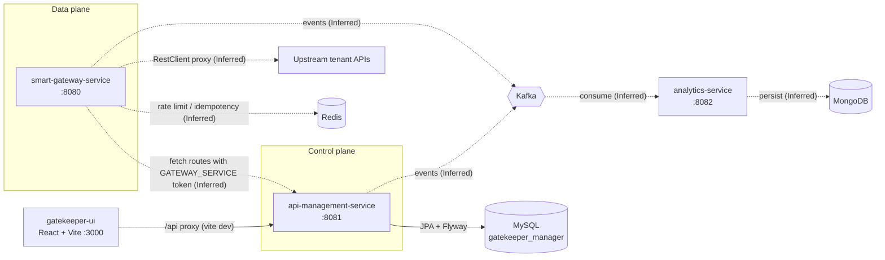
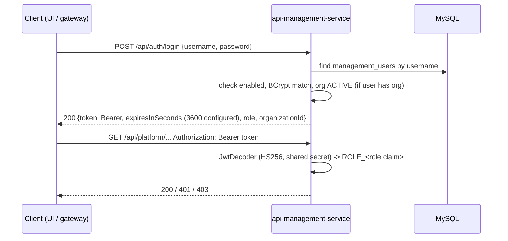

# Gatekeeper Architecture

> **Superseded in part.** This snapshot predates the tenant route-management backend (routes, versions, audit, gateway feed) and the finished admin UI. Sections 2.3, 2.4, 2.5, 5.2, 6 and 7 are out of date. Use [README.md](README.md) and the numbered documents (01 to 08) for the current state.

Generated by the architecture-analyst agent on 2026-10-29 by reading the code in `C:\MyNetwork\gatekeeper`.
Facts below were verified in source files. Anything not directly verified is labelled **Inferred**.
Secret values (DB password, JWT secret, seeded password hashes) are deliberately not reproduced; only their existence and location are noted.

Contents: [1 Overview](#1-system-overview) | [2 api-management-service](#2-api-management-service) | [3 smart-gateway-service](#3-smart-gateway-service) | [4 analytics-service](#4-analytics-service) | [5 Cross-cutting](#5-cross-cutting-concerns) | [6 Frontend](#6-gatekeeper-ui) | [7 Implemented vs scaffold](#7-implemented-vs-scaffold-only) | [8 Observations](#8-observations-and-gaps)

---

## 1. System overview

Gatekeeper is a monorepo of three Spring Boot services and a React UI. The monorepo root has no build file and no `.git` directory (no parent pom); each service has its own `pom.xml` and Maven wrapper. The intended product (**Inferred** from service descriptions and the DB schema) is a multi-tenant API gateway: a control plane (`api-management-service`) stores tenant organizations and route configuration, a data plane (`smart-gateway-service`) proxies traffic, and `analytics-service` collects usage data.

Only the control plane has real logic today. The other two services expose `/health` only (see section 7).

| Component | Tech (verified in pom/package.json) | Port | Datastore |
|---|---|---|---|
| api-management-service | Spring Boot 4.1.2, Java 21, Spring MVC, Spring Data JPA, Flyway, Spring Security + OAuth2 resource server, Validation, Kafka starter, AspectJ starter, Lombok | 8081 | MySQL `gatekeeper_manager` on localhost:3306 |
| smart-gateway-service | Spring Boot 4.1.2, Java 21, Spring MVC, `spring-boot-restclient`, Data Redis, Kafka starter, Security + OAuth2 resource server, Validation, AspectJ starter, Lombok | 8080 | Redis starter present, no config |
| analytics-service | Spring Boot 4.1.2, Java 21, Spring MVC, Data MongoDB, Kafka starter, Security + OAuth2 resource server, Validation, AspectJ starter, Lombok | 8082 | MongoDB starter present, but `MongoAutoConfiguration` is excluded |
| gatekeeper-ui | React 19, Vite 8, TypeScript 7, Tailwind 4 (Vite plugin), react-router-dom 7, oxlint | 3000 (dev) | none |

Java base package: `in.org.gatekeeper.<service_name_with_underscores>` (e.g. `in.org.gatekeeper.api_management_service`).

### Diagram

Solid lines exist in code. Dashed lines are intended/declared by dependencies or schema only and have no implementation (**Inferred** intent).



---

## 2. api-management-service

### 2.1 Responsibility
Control plane. Currently implements: (a) login that issues HS256 JWTs, (b) platform-admin CRUD of organizations (tenants) with soft delete and status management, (c) platform-admin management of one tenant administrator account per organization, (d) `/health` including a DB ping.

### 2.2 Package layout
`src/main/java/in/org/gatekeeper/api_management_service/`

| Package | Contents |
|---|---|
| (root) | `ApiManagementServiceApplication` (plain `@SpringBootApplication`) |
| `config` | `SecurityConfig` |
| `controller` | `AuthenticationController`, `PlatformOrganizationController`, `HealthController` |
| `service` | `AuthenticationService`, `OrganizationService`, `HealthService` |
| `repository` | `ManagementUserRepository`, `OrganizationRepository`, `RoleRepository` (all `JpaRepository<..., Long>`) |
| `entity` | `ManagementUser`, `Organization`, `Role`, enum `OrganizationStatus` |
| `dto.request` | `LoginRequest`, `OrganizationRequest`, `OrganizationStatusRequest`, `TenantAdminRequest` |
| `dto.response` | `LoginResponse`, `OrganizationResponse`, `TenantAdminResponse`, `HealthResponse` |
| `exception` | `ApiException` |

Resources: `application.properties`, `db/migration/V1__create_api_management_schema.sql`, `V2__seed_management_roles.sql`, `V3__seed_platform_accounts.sql`. No test resources; the single test is `contextLoads` (`@SpringBootTest`), H2 is a test-scope dependency.

### 2.3 Endpoints

Authorization is URL-based in `SecurityConfig`; there is no method-level security (`@PreAuthorize` not used).

| Method | Path | Auth | Request DTO | Response | Notes |
|---|---|---|---|---|---|
| GET | `/health` | public | - | 200 `HealthResponse{serviceStatus, dbStatus, timestamp}` | `dbStatus` is `UP`/`DOWN` from `SELECT 1`; service status always `UP` |
| POST | `/api/auth/login` | public | `LoginRequest{username, password}` both `@NotBlank` | 200 `LoginResponse{token, tokenType="Bearer", expiresInSeconds, role, organizationId}` | Intended: 401 invalid credentials/disabled user; 403 if user's organization is not ACTIVE (see 5.3 for how these are actually surfaced) |
| POST | `/api/platform/organizations` | PLATFORM_ADMIN | `OrganizationRequest{name <=150, slug <=100 matching ^[a-z0-9]+(?:-[a-z0-9]+)*$}` | 201 `OrganizationResponse{id, name, slug, status, createdAt, updatedAt}` | New org status = PENDING; intended 409 on duplicate name or slug (case-insensitive) |
| GET | `/api/platform/organizations` | PLATFORM_ADMIN | - | 200 `List<OrganizationResponse>` | Excludes status DELETED; not paginated |
| GET | `/api/platform/organizations/{id}` | PLATFORM_ADMIN | - | 200 `OrganizationResponse` | Intended 404 if missing or DELETED |
| PUT | `/api/platform/organizations/{id}` | PLATFORM_ADMIN | `OrganizationRequest` | 200 `OrganizationResponse` | Uniqueness check ignores the org itself |
| PATCH | `/api/platform/organizations/{id}/status` | PLATFORM_ADMIN | `OrganizationStatusRequest{status}` `@NotNull` | 200 `OrganizationResponse` | Intended 400 if status = DELETED ("Use DELETE") |
| DELETE | `/api/platform/organizations/{id}` | PLATFORM_ADMIN | - | 204 | Soft delete: status=DELETED, `deletedAt` set |
| POST | `/api/platform/organizations/{organizationId}/tenant-admin` | PLATFORM_ADMIN | `TenantAdminRequest{username <=100, password 8..100, enabled=true}` | 201 `TenantAdminResponse{id, organizationId, username, enabled}` | Intended 409 if org already has an admin or username taken; 500 if `TENANT_ADMIN` role row missing |
| GET | `/api/platform/organizations/{organizationId}/tenant-admin` | PLATFORM_ADMIN | - | 200 `TenantAdminResponse` | Intended 404 if none |
| PUT | `/api/platform/organizations/{organizationId}/tenant-admin` | PLATFORM_ADMIN | `TenantAdminRequest` | 200 `TenantAdminResponse` | Password is mandatory on every update and is re-hashed |
| DELETE | `/api/platform/organizations/{organizationId}/tenant-admin` | PLATFORM_ADMIN | - | 204 | Hard delete of the user row |
| any | `/api/tenant/**` | TENANT_ADMIN | - | - | Matcher exists, **no controller maps it** |
| any | `/api/gateway/**` | GATEWAY_SERVICE | - | - | Matcher exists, **no controller maps it** |
| any other | `anyRequest()` | authenticated | - | - | |

### 2.4 Entities and relationships (JPA)

| Entity / table | Fields | Relationships |
|---|---|---|
| `Organization` / `organizations` | id (IDENTITY), name, slug, status (`@Enumerated(STRING)`: PENDING, ACTIVE, SUSPENDED, DELETED), createdAt, updatedAt, deletedAt | none declared on this side |
| `Role` / `roles` | id, name | - |
| `ManagementUser` / `management_users` | id, username, passwordHash, enabled, createdAt, updatedAt | `@ManyToOne(LAZY) organization` (nullable `organization_id`), `@ManyToOne(EAGER) role` (not null) |

Timestamps are set manually in services (no `@CreatedDate`/auditing, no `@PrePersist`).

Repositories (custom methods): `ManagementUserRepository.findByUsername`, `findByOrganizationId`, `existsByUsername`; `OrganizationRepository.existsByNameIgnoreCase`, `existsBySlugIgnoreCase`, `findAllByStatusNot`, `findByIdAndStatusNot`; `RoleRepository.findByName`.

### 2.5 Database schema (Flyway)

`spring.jpa.hibernate.ddl-auto=validate`, `spring.flyway.enabled=true`; Flyway owns the schema.

**V1 `create_api_management_schema`** creates 8 tables:

| Table | Key columns / constraints | Mapped by an entity? |
|---|---|---|
| `organizations` | id PK; unique name; unique slug; status VARCHAR(20); created/updated/deleted_at | yes |
| `roles` | id PK; unique name | yes |
| `management_users` | id PK; unique username; unique organization_id (so max one user per org); FK to organizations and roles; password_hash; enabled | yes |
| `api_routes` | id PK; organization_id FK; route_id (unique with org); name; path_pattern; target_base_url; target_path_prefix; requests_per_minute (nullable); response_timeout_ms; idempotency_enabled; active (default false); configuration_version | **no entity** |
| `route_allowed_methods` | PK (route_pk, http_method); FK to api_routes ON DELETE CASCADE | **no entity** |
| `route_header_rules` | id PK; route_pk FK (cascade); direction; action; header_name; header_value | **no entity** |
| `route_configuration_versions` | id PK; organization_id FK; route_id; version_number (unique per org+route); change_type; configuration_snapshot LONGTEXT | **no entity** |
| `control_plane_audit_records` | id PK; organization_id FK (nullable); actor; action; resource_type; resource_id; correlation_id; duration_ms; result; details | **no entity** |

**V2 `seed_management_roles`**: inserts roles `PLATFORM_ADMIN`, `TENANT_ADMIN`, `GATEWAY_SERVICE`.

**V3 `seed_platform_accounts`**: inserts two users with `organization_id = NULL`: `platform-admin` (role PLATFORM_ADMIN) and `gateway-service` (role GATEWAY_SERVICE), each with a pre-computed BCrypt hash (hashes not reproduced here; they live in `V3__seed_platform_accounts.sql`). The plaintext passwords are not stored anywhere I read.

Inferred: the routing, versioning and audit tables are groundwork for not-yet-built route management, snapshot-based config versioning and an audit trail. `OrganizationService` computes an unused `long startedAt = System.nanoTime()` in most methods, which matches the `duration_ms` audit column (Inferred: audit logging planned, possibly via the AspectJ starter, but no `@Aspect` exists).

### 2.6 Configuration (`application.properties`)

| Key | Value / note |
|---|---|
| `spring.application.name` | `api-management-service` |
| `server.port` | `8081` |
| `info.app.name` / `info.app.description` | descriptive strings copied from the gateway ("Api Gateway Service"); not read by any code in this service |
| `spring.datasource.url` | `jdbc:mysql://localhost:3306/gatekeeper_manager` |
| `spring.datasource.username` | `root` |
| `spring.datasource.password` | **secret present in file**, not reproduced |
| `spring.jpa.hibernate.ddl-auto` | `validate` |
| `spring.flyway.enabled` | `true` |
| `security.jwt.expiration-seconds` | `3600` |
| `security.jwt.secret` | **secret present in file**, not reproduced |

No Kafka properties exist (`spring.kafka.*` absent); see 5.4.

### 2.7 Security model
- Stateless (`SessionCreationPolicy.STATELESS`), CSRF disabled.
- `oauth2ResourceServer().jwt()` with a custom `jwtAuthenticationConverter`: authority = `"ROLE_" + <claim "role">`, principal name = JWT subject. `hasRole("X")` rules therefore match claim values `PLATFORM_ADMIN`, `TENANT_ADMIN`, `GATEWAY_SERVICE`.
- The same service signs and verifies: `JwtEncoder` (Nimbus, HmacSHA256 from `security.jwt.secret`) and `JwtDecoder` (HS256, same secret). Symmetric key.
- `PasswordEncoder` = `BCryptPasswordEncoder`.
- Public: `/health`, `/api/auth/login`.

### 2.8 Business rules worth knowing
- Org lifecycle: created as PENDING; `PATCH status` may set PENDING/ACTIVE/SUSPENDED (any transition allowed, no state machine); DELETED only via `DELETE`.
- Tenant admin login requires its organization to be ACTIVE (otherwise "The organization is not active"). Platform and gateway accounts have no organization and skip this check.
- One tenant admin per organization (DB unique constraint on `management_users.organization_id` and a service pre-check).
- `getOrganization` hides DELETED orgs, so tenant-admin operations on a deleted org fail with "Organization not found".

---

## 3. smart-gateway-service

### 3.1 Responsibility
Intended (**Inferred** from name, description and dependencies): data-plane gateway doing routing, rate limiting (Redis), idempotency (Redis), outbound calls (`RestClient`) and event publishing (Kafka). **None of this is implemented.**

### 3.2 Package layout
`in.org.gatekeeper.smart_gateway_service`: `SmartGatewayServiceApplication`, `config/SecurityConfig`, `controller/HealthController`, `dto/response/HealthResponse`. No service, repository, entity or exception packages.

### 3.3 Endpoints

| Method | Path | Auth | Response |
|---|---|---|---|
| GET | `/health` | public | 200 `HealthResponse{ServiceName, ServiceDescription, appStatus="UP"}` built from `info.app.name` / `info.app.description` |

The `HealthResponse` fields are declared `ServiceName` / `ServiceDescription` (capitalised, package-private). The JSON property names produced by the Lombok getters are **Inferred** to be `serviceName` / `serviceDescription`.

### 3.4 Config
`spring.application.name=smart-gateway-service`, `server.port=8080`, `info.app.name`, `info.app.description`. No Redis, Kafka or JWT settings, and no URL for api-management-service.

### 3.5 Security
`SecurityConfig` permits `/health`, everything else `authenticated()`. It does **not** call `oauth2ResourceServer(...)`, no `jwt.*` properties are set, and no `JwtDecoder` bean is defined. **Inferred:** although the resource-server starter is on the classpath, no bearer-token authentication is wired, so every non-health request is rejected; the gateway cannot yet validate tokens issued by api-management-service. CSRF protection is left at its default (enabled).

---

## 4. analytics-service

### 4.1 Responsibility
Intended (**Inferred**): consume gateway/control-plane events from Kafka and store/query analytics in MongoDB. **Not implemented.**

### 4.2 Package layout
`in.org.gatekeeper.analytics_service`: `AnalyticsServiceApplication` (`@SpringBootApplication(exclude = MongoAutoConfiguration.class)`), `config/SecurityConfig`, `controller/HealthController`, `dto/response/HealthResponse`.

### 4.3 Endpoints

| Method | Path | Auth | Response |
|---|---|---|---|
| GET | `/health` | public | 200 `HealthResponse{appName, appDescription, appHealth="UP"}` |

### 4.4 Config
`spring.application.name=analytics-service`, `server.port=8082`, `info.app.name`, `info.app.description` (the description text is copy-pasted from the gateway: "Custom API Gateway for routing, security and processing"). No Mongo, Kafka or JWT settings.

### 4.5 Security
Identical to smart-gateway-service: `/health` public, rest authenticated, no resource-server/JWT wiring (same Inferred consequence). The Mongo auto-configuration exclusion is verified; its purpose (starting without a MongoDB) is Inferred.

---

## 5. Cross-cutting concerns

### 5.1 Authentication / JWT flow (implemented only in api-management-service)



JWT contents (verified in `AuthenticationService`): header alg HS256; claims `iss="gatekeeper-api-management"`, `iat`, `exp` (= iat + `security.jwt.expiration-seconds`), `sub` = username, `role` = role name, and `organizationId` (only when the user has an organization). There is no refresh token, no logout/revocation, no `aud` claim.

Inferred: the other services will need the same HS256 secret (or a shared decoder) to validate these tokens; currently neither does.

### 5.2 Roles

| Role | Seeded account | Intended scope | Backed by code |
|---|---|---|---|
| PLATFORM_ADMIN | `platform-admin` (V3) | `/api/platform/**` | yes: organization + tenant-admin CRUD |
| TENANT_ADMIN | created via API per organization | `/api/tenant/**` | role and login only; no endpoints |
| GATEWAY_SERVICE | `gateway-service` (V3) | `/api/gateway/**` (**Inferred**: service-to-service route config fetch) | role only; no endpoints |

Tenant scoping: the `organizationId` claim exists, but no code yet filters data by it (no tenant endpoints exist).

### 5.3 Error handling
- `exception/ApiException extends RuntimeException` carries an `HttpStatus` and message; it is thrown across the services (401, 403, 404, 409, 400, 500).
- **Verified:** there is no `@ControllerAdvice`, `@ExceptionHandler`, or `ResponseStatusException` anywhere in the repo. **Inferred consequence:** `ApiException` is not translated to its intended status; Spring Boot's default error handling will treat it as an unhandled exception (HTTP 500 without the custom message) rather than the 401/403/404/409 the code intends. This is why the endpoint table above says "Intended" for those codes. Bean-validation failures (`@Valid`) get Spring's default 400 handling.
- `HealthService` swallows DB errors with `System.out.println` (no logger).
- Only api-management-service has an exception package.

### 5.4 Kafka
`spring-boot-starter-kafka` is a dependency of all three services. **Verified absent:** `KafkaTemplate`, `@KafkaListener`, `@EnableKafka`, topic definitions, and any `spring.kafka.*` property. There are therefore **no topics, producers or consumers** today. Any topic design is Inferred only (e.g. gateway to analytics usage events).

### 5.5 Datastores
- MySQL: used by api-management-service only (section 2.5).
- Redis: dependency in smart-gateway-service, no usage.
- MongoDB: dependency in analytics-service, auto-config excluded, no usage.

### 5.6 Testing
Each service has only the generated `contextLoads` `@SpringBootTest`. **Inferred:** with no test properties file, `ApiManagementServiceApplicationTests` will use the main `application.properties` (MySQL URL, Flyway) unless the environment provides them; H2 is on that service's test classpath but nothing configures it. The UI has no test runner in `package.json`.

### 5.7 Build / run
- Services: Maven wrapper in each folder (`mvnw`, `mvnw.cmd`); Java 21.
- UI: `npm run dev` (port 3000, strictPort), `npm run build` (`tsc -b && vite build`), `npm run lint` (oxlint), `npm run preview`.
- Local ports: gateway 8080, api-management 8081, analytics 8082, UI 3000.
- Dev proxy: Vite proxies `/api` to `http://localhost:8081` (api-management-service).
- Tooling folders at root: `.claude/agents` (agent definitions), `.codemie` (empty), `.idea`.

---

## 6. gatekeeper-ui

### 6.1 Stack
React 19.3, react-dom 19.3, react-router-dom 7.18, Tailwind CSS 4.3 via `@tailwindcss/vite`, Vite 8 with `@vitejs/plugin-react`, TypeScript ~7.0 (`tsc -b`), oxlint (plugins react, typescript, oxc; rules `react/rules-of-hooks` = error, `react/only-export-components` = warn with `allowConstantExport`). ES modules (`"type": "module"`).

### 6.2 Folder structure (current)
```
gatekeeper-ui/
  index.html            (title "gatekeeper-ui", mounts #root, loads /src/main.tsx)
  vite.config.ts        (react + tailwind plugins; dev server localhost:3000; /api proxy -> :8081)
  tsconfig.json / tsconfig.app.json / tsconfig.node.json
  .oxlintrc.json
  public/               favicon.svg, icons.svg
  src/
    main.tsx            StrictMode + createRoot, renders <App />
    App.tsx             Vite starter template (counter + docs links); uses useState only
    App.css, index.css  starter styles (custom CSS variables, light/dark via color-scheme)
    assets/             hero.png, react.svg, vite.svg
    api/                EMPTY
    componenets/        EMPTY   (sic: existing typo, documented as-is)
    pages/              EMPTY
    routes/             EMPTY
```

### 6.3 Routing
`react-router-dom` is installed but **not used**: no `BrowserRouter`, `createBrowserRouter`, `Routes` or `Route` exist anywhere in `src`. `routes/` is empty.

### 6.4 API layer
`src/api/` is empty; no `fetch`/axios code exists. The only API-related configuration is the dev proxy `/api` to `http://localhost:8081`, so relative `/api/...` URLs will reach api-management-service in dev. No auth/token storage, interceptors or typed DTO mirrors exist yet.

### 6.5 Conventions in use (verified)
- TypeScript flags in `tsconfig.app.json`: `noUnusedLocals`, `noUnusedParameters`, `erasableSyntaxOnly` (no enums/namespaces/parameter properties), `verbatimModuleSyntax` (use `import type` for types), `noFallthroughCasesInSwitch`; `allowImportingTsExtensions` (existing code imports with the extension, e.g. `import App from './App.tsx'`).
- `tsconfig.app.json` does **not** set `"strict": true` (verified); whether TypeScript 7 defaults to strict is not verified.
- Function components with hooks, default export for `App`; single quotes and no semicolons in the existing files.
- Styling: **Tailwind is configured as a Vite plugin, but neither `index.css` nor `App.css` contains an `@import "tailwindcss"`** (verified by grep), so Tailwind utilities are currently not loaded. Existing styling is plain CSS with CSS custom properties.
- The `componenets` directory is spelled that way in the repo; new code should import from it as-is unless it is deliberately renamed.

---

## 7. Implemented vs scaffold only

| Area | Status | Evidence |
|---|---|---|
| api-management: login + JWT issuing | Implemented | `AuthenticationController/Service` |
| api-management: organization CRUD, status, soft delete | Implemented | `PlatformOrganizationController`, `OrganizationService` |
| api-management: tenant-admin CRUD | Implemented | same |
| api-management: `/health` with DB check | Implemented | `HealthController`, `HealthService` |
| api-management: Flyway schema + role/account seeds | Implemented | V1-V3 |
| api-management: route management (`api_routes`, header rules, methods) | Schema only | tables in V1, no entity/repo/service/controller |
| api-management: route config versioning | Schema only | `route_configuration_versions` |
| api-management: audit trail | Schema only | `control_plane_audit_records`; unused `startedAt` timers |
| api-management: `/api/tenant/**`, `/api/gateway/**` | Security rules only | no controllers |
| api-management: global exception handler | Missing | no `@ControllerAdvice` |
| api-management: Kafka | Dependency only | no usage/config |
| smart-gateway-service | Scaffold (HealthController only) | proxying, Redis, Kafka, JWT validation all absent |
| analytics-service | Scaffold (HealthController only) | Mongo auto-config excluded, Kafka and JWT absent |
| Kafka topics / producers / consumers | None anywhere | grep verified |
| Service tests | `contextLoads` only | one test class per service |
| gatekeeper-ui | Vite starter template | `App.tsx` is the stock demo; `api`, `componenets`, `pages`, `routes` are empty folders |
| UI routing / auth / API client | Not started | no code |

---

## 8. Observations and gaps

Verified unless marked Inferred.

1. **Secrets in repo config.** `application.properties` in api-management-service holds a DB password and the JWT HMAC secret in plain text, and V3 contains seeded account password hashes. Move secrets to environment variables or a vault before any shared deployment.
2. **`ApiException` has no handler** (see 5.3): Inferred that clients get 500s instead of 401/403/404/409.
3. **Gateway and analytics cannot validate JWTs** (no decoder/resource-server config); any endpoint added there would be inaccessible with a valid token until this is wired.
4. **HS256 shared secret** means any service verifying tokens must hold the signing secret (Inferred risk).
5. **Seeded privileged accounts** (`platform-admin`, `gateway-service`) are created by migration V3 with committed hashes.
6. **Organization status transitions are unrestricted**: `PATCH` can reactivate a SUSPENDED org or set it back to PENDING.
7. **`PUT .../tenant-admin` requires a password** every time; there is no partial update or separate password-change endpoint.
8. **Dead/misleading config**: unused `startedAt` locals in `OrganizationService`; `info.app.*` in api-management-service is unused and mislabelled ("Api Gateway Service"); analytics-service `info.app.description` is copied from the gateway.
9. **`HealthResponse` shapes differ per service** (api-management: `serviceStatus/dbStatus/timestamp`; gateway: `ServiceName/ServiceDescription/appStatus`; analytics: `appName/appDescription/appHealth`).
10. **UI**: Tailwind not imported in CSS, react-router-dom unused, `strict` not enabled in `tsconfig.app.json`.
11. No monorepo-level README, CI config or docker-compose files were found at the repository root.
